  
  
  
  
  

---

### About Me

- 🔭 I’m currently working on: **OOAD, IAI, TAFL projects**
- 🌱 I’m currently learning: **Machine Learning, Object Oriented Analysis & Design, System Design**
- 👯 I’m looking to collaborate on: **Open Source Projects and AI Hackathons**

---

### Tech Stack

**Languages:** Python, TypeScript, Dart, C++, C, Java

**Frontend & Mobile:** Flutter, Angular 19/22, React 19, Streamlit, HTML5, CSS3, Qt Framework

**Backend:** Spring Boot, NestJS, FastAPI, Google Agent Development Kit (ADK) 2.0

**Database:** MongoDB Atlas, MySQL

**Tools:** Git & GitHub, Antigravity, VS Code, Cursor, Postman, Swagger API, MongoDB Compass

   
   
   
  

---

### 📊 GitHub Stats

  
  

 

  

 

---
### 📈 Contribution Graph

  <picture>
    <source media="(prefers-color-scheme: light)" srcset="https://raw.githubusercontent.com/SyedMuhammadHunain/SyedMuhammadHunain/output/github-contribution-grid-snake-dark.svg">
    <source media="(prefers-color-scheme: dark)" srcset="https://raw.githubusercontent.com/SyedMuhammadHunain/SyedMuhammadHunain/output/github-contribution-grid-snake.svg">
    
  </picture>

---

### 📌 Pinned Projects

  
  
  
  
  
  

---

### Featured Projects

| Project | Description | Tech Stack |
| :--- | :--- | :--- |
| **[ResQ Emergency Dispatch](https://github.com/SyedMuhammadHunain/Emergency-Vehicle-Allocation-and-Route-Optimization-System)**  [Live Platform](https://res-q.tech/) • [Android APK](https://res-q.tech/app-release.apk) | Emergency vehicle allocation and route optimization for Karachi with Citizen, Dispatcher, Driver and Admin portals: 0/1 Knapsack fleet assignment and dynamic Dijkstra routing over a 900-node road graph with instant rerouting. | Flutter, Dart, Django REST, Python, MySQL |
| **[Social Media Content Analysis System](https://github.com/SyedMuhammadHunain/social-media-content-analytic-system)** | Enterprise-grade creator analytics and telemetry platform for NED University OOAD (CT-263) featuring creator performance dashboards and scalable microservices. | React 19, TypeScript, Java 21, Spring Boot 3.4, MongoDB Atlas |
| **[Low-Water Crops](https://github.com/SyedMuhammadHunain/Climate-Machine-Learning)**  [Web App](https://climate-machine-learning.vercel.app/) • [Streamlit App](https://climate-machine-learning-nb5v2knz3htvseqqpuhvrk.streamlit.app/) • [Model on Hugging Face](https://huggingface.co/SMHunain/crop-yield-drought-pakistan) | Climate-resilient crop selection under drought: a trained model predicts the yield of 13 crops in Punjab, Sindh and Balochistan and ranks them by how much of a typical year they keep. | Python, scikit-learn, FastAPI, Streamlit, Vercel |
| **[TechSaathi AI (Tech Mentor)](https://github.com/SyedMuhammadHunain/tech-mentor)**  [Live App](https://techsaathi-app.vercel.app) • [Demo Video](https://vimeo.com/1241706071?share=copy) | AI-powered digital literacy and banking education mobile app with bilingual AI tutor (English & Urdu), 14 banking modules, demo bank simulator, and ScamShield SMS fraud detector. | Flutter, Dart, Firebase, Gemini AI |
| **[Climate Shield 360](https://github.com/SyedMuhammadHunain/ClimateSheild-360-dataset)**  [Devpost](https://devpost.com/software/climatesheild-360) • [Presentation Slides](https://1drv.ms/p/c/039a57ad0c047521/IQAOfbXBF-QGSaJzD0gTNnbUAX_-PnRphoFJvXiaN0oEPug?e=pMsW8s) | Predictive urban road inundation and climate flood risk assessment platform integrating real-time meteorology (Open-Meteo), GloFAS river discharge, and OpenStreetMap spatial infrastructure. | Python, Open-Meteo, GloFAS, GIS, Machine Learning |
| **[Agriculture Expert System](https://github.com/SyedMuhammadHunain/expert-system)**  [Live App](https://syedmuhammadhunain-expert-system-app-bjg0e0.streamlit.app/) | Production-grade agronomy expert system (Kisan Rahbar) for Pakistani farmers with 60 codified rules for crop disease diagnosis, pest mitigation (PHI safety locks), and NPK fertilizer prescriptions. | Pure Python, Streamlit, Forward Chaining, MYCIN CFs |
| **[Revisio](https://github.com/SyedMuhammadHunain/revisio)** | Learning platform to master DSA, OOP, and PF featuring a RAG-powered AI, performance analytics, smart proctoring, and more. | Angular 19, NestJS, MongoDB |
| **[WebCode`25 FinConnect](https://github.com/SyedMuhammadHunain/webcode25-finconnect-backend)**  [Demo Video](https://vimeo.com/1096358750/925001f741) | Developer-focused sandbox portal allowing users to register, subscribe to plans, and access mock financial APIs secured with JWT and RBAC. | Angular, NestJS, MongoDB |

---

### Connect With Me

  <i>If you like my work, consider giving a star to my repositories!</i>

  

